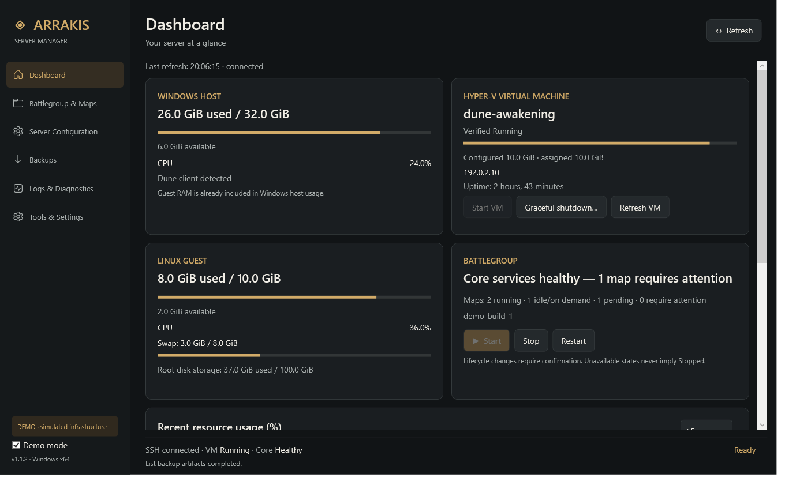
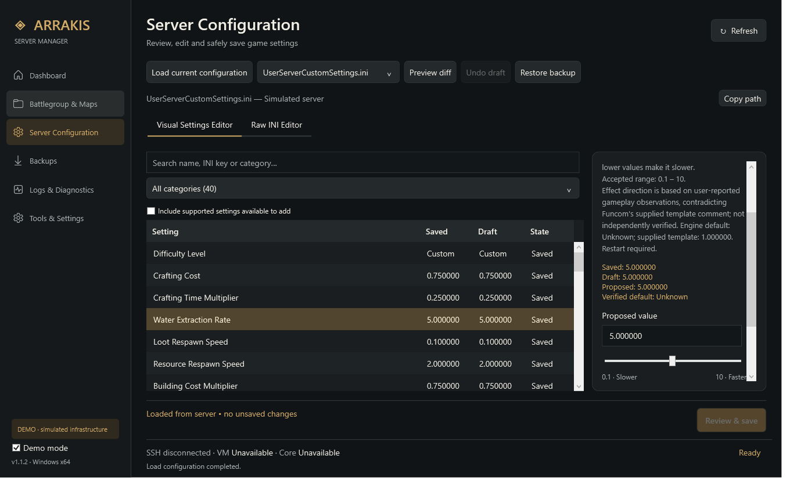
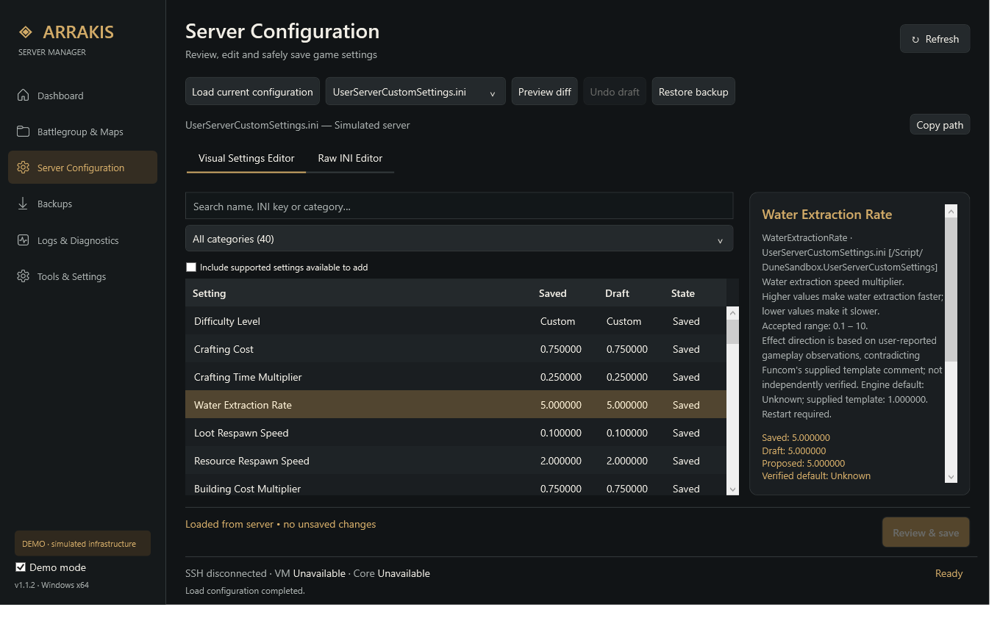
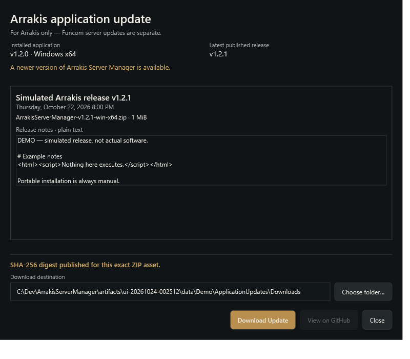
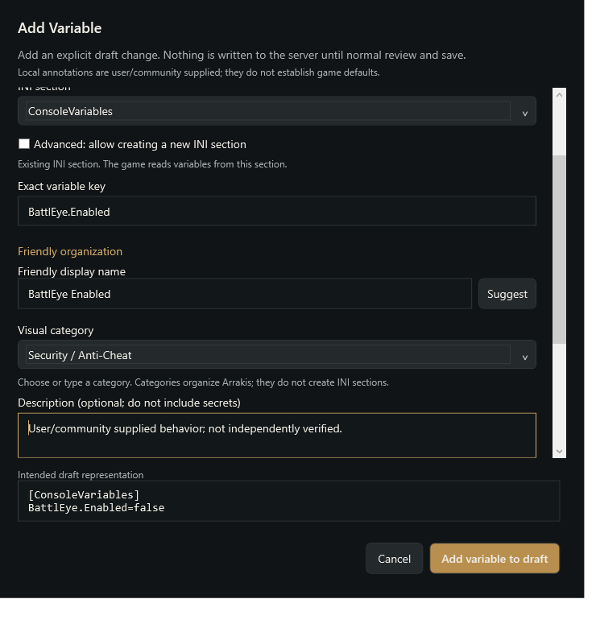
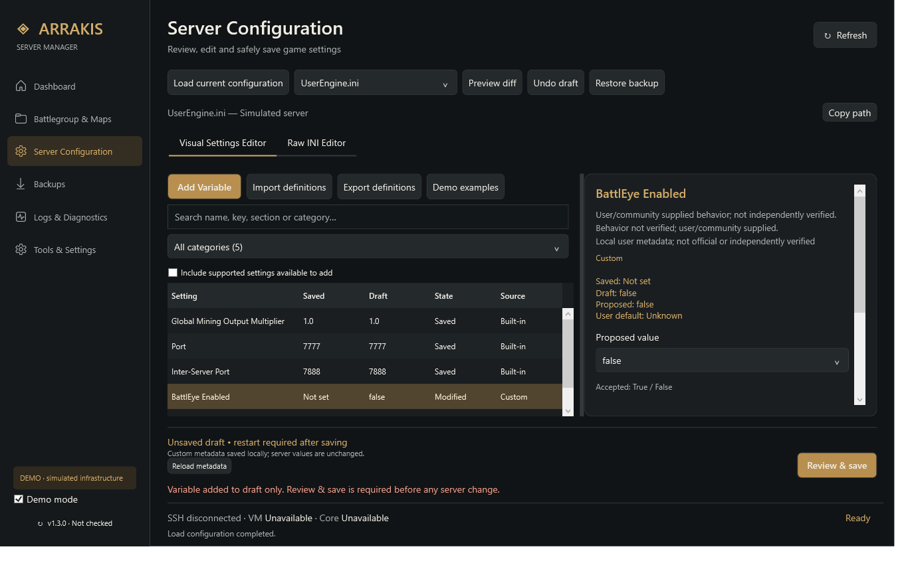
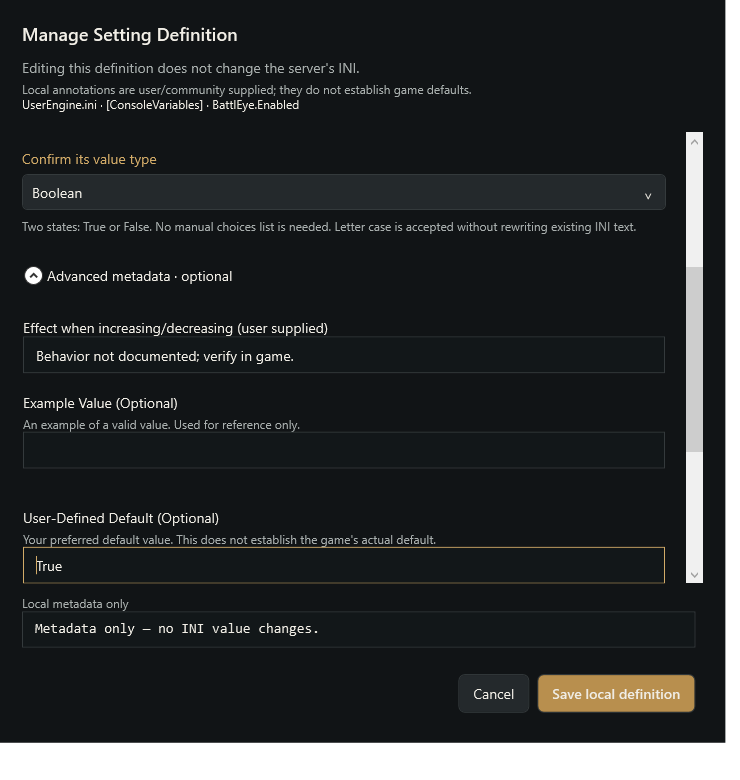

# Arrakis Server Manager

A native Windows desktop control center for an **existing official Dune: Awakening self-hosted server**. Monitor your Windows host, Hyper-V guest and battlegroup, review configuration changes, and manage supported administrative workflows from one WPF application.

**Version v1.3.0 · Windows x64 · .NET 10**

The final metadata refinement gives Example Value and User Default separate labels, type-aware validation and proposal-only reset. Metadata never silently changes INI values.

v1.3.0 adds discovery of custom scalar INI variables, local definitions and categories, a guided Add Variable window, friendly names and a persisted split editor. Unknown types/ranges/effects are not guessed; ambiguous directives stay raw-only. All existing save-integrity and application-update safeguards remain. See [Custom configuration](docs/CUSTOM-CONFIGURATION.md) and [v1.3.0 release notes](docs/RELEASE-v1.3.0.md). The user accepted the configuration editor and final metadata refinements. The local stable baseline is finalized; GitHub publication requires separate approval.

v1.2.0 adds independent GitHub checks and SHA-256-verified downloads for **Arrakis itself**, with a dynamic sidebar version, release-details dialog and automatic-check preference. The refined dialog keeps version/status and download progress/actions fixed, uses one release-information scroller and collapses installation help. Canceled, failed and verified states have explicit messages and contextual actions. Installation remains manual. These controls do not apply Funcom game-server updates. See [Application updates](docs/APPLICATION-UPDATES.md) and [v1.2.0 acceptance](docs/RELEASE-v1.2.0.md). v1.2.0 remains the published stable baseline, preserved unchanged during v1.3.0 development.

v1.1.2 corrects `WaterExtractionRate`: **higher = faster water extraction; lower = slower**. This follows user-reported gameplay observations that contradict Funcom's supplied template comment; the direction has not been independently verified during development. The 0.1–10 range, key, values and save behavior are unchanged. Existing server comments are preserved rather than silently rewritten. The committed/tagged v1.1.1 stable baseline remains intact; see [the correction notes](docs/RELEASE-v1.1.2.md).

This is an independent, unofficial community project. It is not affiliated with, endorsed by, or supported by Funcom or the owners of Dune. Dune: Awakening and related names belong to their respective owners. The application does not include, download or install Funcom's proprietary server software, game assets, Steam content or server credentials. Obtain and configure the official server separately using [Funcom's self-hosting instructions](https://duneawakening.com/self-hosted-servers/).

## Features

- **Dashboard:** Windows and guest resource usage, recent resource history, VM state, battlegroup health, and state-aware lifecycle controls. Unavailable status stays distinct from stopped status.
- **Configuration Editor 2.0:** precise sliders and typed values, searchable categories, separate saved/draft/proposed values, semantic no-op detection, and synchronized visual/raw INI editing.
- **Reviewed configuration saves:** original-file hash checks, a frozen reviewed payload, compatible remote locking, encrypted local backups, remote rollback copies, atomic replacement and readback verification. Visual edits preserve comments, unknown settings, encoding and line endings.
- **Maps and infrastructure:** Game Maps, Infrastructure and All views; validated map-resource proposals; completed utility/Job handling; and Idle / On demand only when configuration explicitly supports that state.
- **Backups and diagnostics:** verified downloads, bounded log views, current versus historical Kubernetes events, copyable error details, official-editor fallback and durable unknown-outcome recovery guidance.
- **Isolated Demo mode:** explore the UI with simulated infrastructure before connecting to a server.
- **Arrakis application updates:** cached anonymous GitHub stable-release checks, an opt-out setting, forced manual checks, safe plaintext notes and cancellable streaming ZIP downloads verified with the exact asset's SHA-256. No extraction, execution, elevation or automatic replacement/restart.

## Screenshots

These captures use simulated adapters, fixture settings and a documentation-only IP address. They contain no live server captures or credentials.















## Requirements

- An x64 Windows installation supported by [.NET 10](https://learn.microsoft.com/en-us/dotnet/core/install/windows). Windows 11 with Hyper-V is the intended desktop host for the official Windows server workflow. Hyper-V availability depends on your Windows edition, hardware virtualization and existing server setup.
- An already installed, configured official server and Hyper-V VM. Server capacity requirements are separate from this desktop application's requirements; follow Funcom's guidance.
- Windows OpenSSH Client, an existing server SSH key, and permission to access it. Keys and passwords are not supplied with this project.
- The Hyper-V PowerShell module and appropriate account permissions for VM discovery and management. SSH monitoring alone does not grant Hyper-V access.
- The inspected Funcom CLI/Kubernetes layout described in [Compatibility](docs/COMPATIBILITY.md). Automatic mutations are deliberately disabled when the installed CLI digest or resource schema is not recognized. This is not a universal compatibility claim.
- A display capable of the application's 1040 × 700 minimum window in Windows logical pixels.

The ZIP is self-contained: a separate .NET installation, browser, Node.js or local web service is not required to run it. The included Microsoft runtime components have separate [license terms](BUNDLED-RUNTIME-TERMS.md). Application-update checks need ordinary anonymous HTTPS access to GitHub; they do not require a Dune connection, Hyper-V permissions, elevation or a GitHub account/token. Offline failure leaves normal administration available.

## Download and install

1. Published builds are on [Releases](https://github.com/sdfox945/ArrakisServerManager/releases). The prepared v1.3.0 ZIP/checksum are under `artifacts/release/packages-v1.3.0-final`; download **ArrakisServerManager-v1.3.0-win-x64.zip** and **SHA256SUMS.txt** from its GitHub Release once published. Existing public assets remain unchanged until publication. GitHub's source archives are not runnable applications.
2. Run `Get-FileHash .\ArrakisServerManager-v1.3.0-win-x64.zip -Algorithm SHA256` and compare the complete hash with its SHA256SUMS.txt. Use checksums from the same release. A checksum detects changed bytes; it is not an independently authenticated software signature.
3. Extract the entire ZIP into a local folder. Keep the executable, adjacent DLLs, launchers, documentation and licenses together. Do not run the executable from inside the ZIP or copy only the EXE.
4. Read [LICENSE](LICENSE), [bundled runtime terms](BUNDLED-RUNTIME-TERMS.md) and [acceptance limitations](docs/ACCEPTANCE-v1.1.1.md). Launch **Launch Demo.cmd** first; Demo uses isolated simulated infrastructure and needs no elevation.
5. For Live mode, launch **ArrakisServerManager.exe**, or use **Launch as Administrator.cmd** when your Hyper-V workflow requires elevation. The administrator launcher requests Windows UAC; approve only if you intend to run this application elevated. A different Windows account has different preferences, keys and DPAPI-protected backups.
6. Check the detected installation/VM, existing SSH key and IP address in **Tools & Settings**. Save connection changes before refreshing. Review a new host fingerprint against the VM console or another trusted source. Changed host identities fail closed; do not bypass host verification.

The executable is unsigned. Windows may show a publisher/reputation warning; verify the source and download before deciding whether to run it. The built-in application checker/downloader does not install or run anything. Close Arrakis yourself, extract the complete ZIP into a new/chosen folder and launch it yourself. Keep adjacent files and the existing application-data preferences/history/safety state. There is no installer, Windows service or unattended self-updater. Keep an earlier release folder if needed.

## Operational safety and acceptance

v1.3.0 passes 334 automated tests including 88 native WPF workflows; the user accepted its configuration editor and metadata refinements. Automated mutations use isolated simulations, not production. The user accepted the live UI/configuration preview for v1.1.1, the earlier v1.0.2 save workflow, the v1.1.2 water-guidance correction and v1.2.0 update detection/cancellation/verified-download behavior. The final dialog refinement retains all 243 existing tests and adds 13 native UX regressions, for 256 tests / 58 native WPF workflows overall. Downloads use mocked HTTP and isolated files; mutation scenarios use simulated gateways or private BusyBox containers. This does not add independent gameplay or disruptive-operation verification.

**VM graceful shutdown/startup, battlegroup lifecycle transitions, individual map-resource modifications/reconciliation, database restore, server updates and other unexercised disruptive operations still require separate live acceptance.** Passing simulations or reviewing a preview does not establish that these operations succeeded on a live server. Physical multi-monitor DPI transitions and UAC behavior also require manual acceptance on the target machine.

Keep independent server/database backups. Runtime disruptive actions require explicit confirmation. A configuration review must show only the changes you intend; cancel and reload if it does not. Engine settings may require a separately confirmed restart to take effect.

If an operation reports an **unknown outcome**, further mutations are blocked. Inspect the affected live file/state and official console first, determine whether an operation remains in progress, and only then use **Acknowledge reviewed unknown outcome**. Do not clear the guard simply to retry. See [Troubleshooting](docs/TROUBLESHOOTING.md) and [acceptance status](docs/ACCEPTANCE-v1.1.1.md).

## Troubleshooting and privacy

| Symptom | Action |
| --- | --- |
| Hyper-V access denied or VM unavailable | Verify module/account permissions; use the administrator launcher if appropriate. Unavailable does not mean the VM is stopped. |
| SSH cannot connect | Verify the running VM, saved IP override, existing key path and trusted host identity. No replacement key is generated automatically. |
| CLI changed / automatic writes disabled | Follow the compatibility fallback. A changed CLI must be reviewed and tested; changing its pinned hash alone is unsafe. |
| Save conflict or verification failure | Reload and inspect the live file and operation details before preparing a new diff. Keep rollback copies. |
| Backup shown as unverified | Inspect the size/hash receipt and verify a local copy. A configuration backup is not a database backup. |
| Window or controls do not fit | Use at least the minimum logical window size; check Windows scaling. See the target-machine acceptance limits above. |

Preferences, operation history, SSH host pins and encrypted configuration backups are stored under `%LOCALAPPDATA%\ArrakisServerManager`; the Demo launcher uses its separate `Demo-v1.3.0` directory. Application updates use a separate `Downloads` folder and `application-update-cache.json`. Automatic GitHub checks default on, cache successes for 24 hours and can be disabled in Tools; manual checks remain available. Only ordinary release API/asset requests are made—no SSH keys, credentials, server settings or VM details are sent. Demo update scenarios use simulated HTTP and inert ZIP fixtures, never real GitHub requests. Private keys are referenced, not bundled. The app does not upload diagnostics automatically; review exported logs/backups before sharing. Microsoft runtime crash reporting has separate terms/Windows settings.

Report reproducible problems through [GitHub Issues](https://github.com/sdfox945/ArrakisServerManager/issues), using Demo/sanitized data where possible. Include the application version and concise operation/error details. Never attach SSH keys, service tokens, passwords, production INI files, databases or unreviewed log archives to a public issue.

## Build and test from source

Use Windows, .NET SDK **10.0.402** (or the compatible patch allowed by `global.json`) and PowerShell. No application `PackageReference` dependencies are used beyond .NET/Windows Desktop framework packs. The full test suite also needs a Linux Docker engine with this pinned BusyBox image available:

```powershell
docker pull busybox@sha256:bdf57e528e45e4433820e045b29b4597825a1c9e38353532d90a01445013f82e
.\scripts\build.ps1
```

The default suite uses isolated test adapters and containers. `--live-read-only` is a separate, opt-in probe and is not part of that suite. Native tests need an interactive Windows desktop; keyboard/focus-sensitive checks can be affected by concurrent desktop interaction. Tests and screenshots are written under ignored `artifacts/`.

For a local self-contained build, run `.\scripts\build.ps1 -Publish`, then `.\scripts\test-ui.ps1` for six pages plus the Demo update dialog/download smoke. `.\scripts\package.ps1` produces the local ZIP, full per-file manifest and SHA256SUMS.txt; it refuses to overwrite an existing package. These commands never upload anything. Runtime/license notices are included. The new custom-configuration subset is `dotnet run --project tests/Arrakis.Tests -c Release -- --custom-config`. The offline updater subset is `dotnet run --project tests/Arrakis.Tests -c Release -- --application-updates`; the existing `--correction`, `--stabilization`, `--enhancements` and `--editor-native` subsets remain. See [Testing](docs/TESTING.md), [Architecture](docs/ARCHITECTURE.md), [Application updates](docs/APPLICATION-UPDATES.md), historical release reports and [Changelog](CHANGELOG.md).

## License and attribution

Original project code and project-authored contributions, including the custom programmatically drawn application icon, are offered under the [MIT License, Copyright (c) 2026 Steven Fox](LICENSE). Third-party material is not relicensed by that notice; see [THIRD_PARTY_NOTICES.md](THIRD_PARTY_NOTICES.md) and [BUNDLED-RUNTIME-TERMS.md](BUNDLED-RUNTIME-TERMS.md). The retained source-only configuration fixture includes third-party-origin functional material with its own [provenance and license-scope explanation](docs/FIXTURE-PROVENANCE.md). No Funcom server software, official artwork, private keys or game data is bundled.
